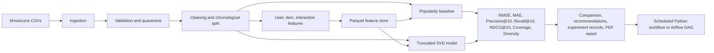

# End-to-End Movie Recommendation Pipeline

ROLL NUMBER: 2025AG05563

GitHub repository: https://github.com/QuickLearnerQ/DM4ML

This repository implements a reproducible MovieLens recommendation pipeline using a custom JSONL experiment tracker, Parquet feature snapshots, a popularity baseline, a personalized truncated-SVD model, offline ranking evaluation, and scheduled Python or optional Airflow orchestration.

## Architecture



The workflow refreshes the rendered [`docs/pipeline_architecture.png`](docs/pipeline_architecture.png) and the editable Mermaid source is at [`docs/pipeline_architecture.mmd`](docs/pipeline_architecture.mmd).

## Code layout

| Module | Responsibility |
|---|---|
| `configs/pipeline.json` | Train/test split, ranking, and model settings |
| `src/config.py` | Shared project paths, schema constants, and settings validation |
| `src/ingestion.py` | Dataset acquisition and CSV loading |
| `src/validation.py` | Schema/value checks, normalization, error quarantine |
| `src/preparation.py` | Chronological split, user summary, sparse matrix |
| `src/transformation.py` | Point-in-time and cutoff feature engineering |
| `src/feature_management.py` | Named Parquet offline feature store |
| `src/model_training.py` | Recommender implementations and rating error helpers |
| `src/evaluation.py` | Ranking, coverage, diversity, and regression metrics |
| `src/tracking.py` | Append-only JSONL experiment run records |
| `src/reporting.py` | Feature catalog, architecture image, final PDF |
| `src/pipeline.py` | Thin dependency-ordered workflow coordinator |
| `src/scheduler.py` | One-shot and interval execution |
| `dags/recommendation_pipeline.py` | Optional daily Airflow entry point for the same workflow |

## Setup

Python 3.10+ is recommended. From the project root:

```powershell
python -m venv .venv
.\.venv\Scripts\Activate.ps1
python -m pip install -r requirements.txt
python -m ipykernel install --user --name recommendation-pipeline --display-name "Python (Recommendation Pipeline)"
```

Select the `Python (Recommendation Pipeline)` kernel when opening the notebook; the notebook is configured to use this environment, which includes the Parquet engine (`pyarrow`). If VS Code selected another kernel, use the notebook's kernel picker to select `Python (Recommendation Pipeline)` and restart the kernel before running all cells. The generic system `Python 3` kernel may not have the project dependencies installed.

## Dataset provenance

The interaction and catalog data are public MovieLens data. The acquisition code first attempts the [GroupLens MovieLens latest-small download](https://grouplens.org/datasets/movielens/latest/) and falls back to the public [`ashraq/movielens_ratings` Hugging Face dataset](https://huggingface.co/datasets/ashraq/movielens_ratings) if GroupLens cannot be downloaded.

The data currently in `data/ml-latest-small/` is the 100,000-row mirror slice: it contains 25,441 users and 7,312 movies. The mirror does not provide authoritative event timestamps in this workflow. Its timestamps are generated deterministically (NumPy seed 42), so **the time-based split is reproducible but does not represent real event chronology**. A fresh acquisition from GroupLens instead uses its source timestamps. Record which source was used when comparing runs; the two inputs and resulting metrics are not interchangeable. The project does not fabricate ratings or movie metadata.

## Run the complete workflow

Run once:

```powershell
python src\pipeline.py
```

Run through the structured scheduler once, or repeat every 24 hours:

```powershell
python src\scheduler.py
python src\scheduler.py --interval-hours 24
```

The scheduler calls the same ordered workflow on each run; it sleeps between completed runs and surfaces failures rather than marking failed runs successful. Stop a repeating run with Ctrl+C.

The shared settings are in `configs/pipeline.json`; invalid values fail at startup. To run with Airflow, install Apache Airflow separately using its version-specific installation constraints, install this project's `requirements.txt` in the Airflow environment, and place the repository's `dags/` directory on Airflow's DAG path. The `recommendation_pipeline` DAG runs daily, retries a failed run once, and invokes the same dependency-ordered pipeline as the local scheduler.

## Workflow and outputs

| Stage | Implementation | Main output |
|---|---|---|
| Ingestion | MovieLens ratings, movies, links CSV | `data/ml-latest-small/` |
| Validation | Required field/type, rating, timestamp, duplicate, and reference checks | `outputs/validation_report.json`; invalid rows with reasons in `data/errors/invalid_interactions.csv` |
| Preparation | Stable chronological holdout; train timestamps strictly precede test timestamps | `data/processed/train.csv`, `test.csv`, user/item tables, sparse `user_item_matrix.npz` and ID maps |
| Transformation | UTC interaction-time fields and train-cutoff aggregates | `data/features/*.parquet` |
| Feature management | Reusable user/item/interaction Parquet snapshots | `docs/feature_catalog.csv` |
| Model training | Interaction-count popularity baseline and personalized truncated-SVD collaborative filtering | `models/*.pkl` |
| Evaluation | RMSE, MAE, Precision@K, Recall@K, NDCG@K, Coverage, and Diversity; K configured in `configs/pipeline.json` | `outputs/model_comparison.csv` and `.json` |
| Tracking | JSONL experiment records contain parameters, metrics, and artifact paths | `outputs/experiment_tracking.jsonl` |
| Orchestration | Repeatable scheduled Python workflow or optional daily Airflow DAG | `src/scheduler.py`; `dags/recommendation_pipeline.py` |

Ranking relevance is held-out ratings of at least four stars. Precision, Recall, and NDCG are averaged over a deterministic sample of up to 1,000 users with at least one relevant test item; `RankingUsers`, `RankingPopulation`, and `RankingSampled` are in the comparison output. The cap bounds catalog-scoring runtime on the public mirror while making the comparison reproducible. Coverage is the share of catalog items recommended for the evaluation sample, and Diversity is mean pairwise genre Jaccard distance. RMSE and MAE are computed over the full test set for explicit ratings.

The final run generates `reports/final_report.pdf` with dataset provenance and timestamp limitations, design decisions, model comparison, and limitations. It also includes two image-based execution-evidence pages covering ingestion, validation, preparation, feature management, model training, evaluation, experiment tracking/reporting, and orchestration. These evidence snapshots are compiled from the successful run's generated artifacts; the orchestration panel documents the scheduler/DAG configuration rather than claiming an Airflow execution. The machine-readable success summary is `outputs/metrics.json`; validation details and the model comparison are also persisted under `outputs/`.

For the submission's successful-run screenshot, run the current workflow in a visible terminal and save a screenshot showing the final `Pipeline completed successfully.` message and the `status: passed` summary as `docs/successful_run.png`. The checked-in screenshot predates the popularity-baseline update and should be recaptured after running the updated workflow. The screenshot is a manual capture because the local scheduler runs in a terminal and does not have a browser-based orchestration UI.

## Tests

```powershell
.\.venv\Scripts\python.exe -m unittest discover -s tests -v
```

For lint and formatting checks, install the development dependencies and run:

```powershell
python -m pip install -r requirements-dev.txt
ruff check src tests
ruff format --check src tests
```

The unit tests cover validation/quarantine, chronological splitting, point-in-time features, popularity ranking, vectorized predictions, and model evaluation. The stage modules contain the implementations; `pipeline.py` only composes them.

## Limitations

MovieLens is a sparse, explicit-rating benchmark. A chronological split better simulates future events but leaves cold-start entities and may be less representative than a production stream. Offline ranking metrics and genres are proxies, not evidence of online user impact. The JSONL tracker is intentionally local and does not provide a hosted experiment UI or model registry.
