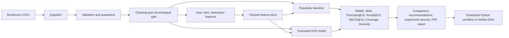

# End-to-End Movie Recommendation Pipeline

ROLL NUMBER: 2025AG05563

GitHub repository: https://github.com/QuickLearnerQ/DM4ML

This repository implements a reproducible MovieLens recommendation pipeline using a custom JSONL experiment tracker, Parquet feature snapshots, a popularity baseline, a personalized truncated-SVD model, offline ranking evaluation, and scheduled Python or optional Airflow orchestration.

## Architecture



The workflow refreshes the rendered [`docs/pipeline_architecture.png`](docs/pipeline_architecture.png) and the editable Mermaid source is at [`docs/pipeline_architecture.mmd`](docs/pipeline_architecture.mmd).

## Code layout

```text
data/
  raw/                 MovieLens source CSVs
  processed/           Train/test splits and sparse interaction matrix
  features/            Parquet feature tables
  errors/              Quarantined invalid interactions
src/
  ingestion/           Raw data acquisition and loading
  validation/          Data quality checks
  preparation/         Chronological split and prepared datasets
  transformation/      Derived and point-in-time features
  features/             Feature store and retrieval APIs
  training/             Recommenders and experiment tracking
  evaluation/           Offline rating and ranking metrics
  config.py, pipeline.py, scheduler.py, reporting.py
dags/                  Optional Airflow DAG
configs/               Pipeline settings
models/                Serialized model artifacts
reports/               Final report and execution evidence
```

| Module | Responsibility |
|---|---|
| `configs/pipeline.json` | Train/test split, ranking, and model settings |
| `src/config.py` | Shared project paths, schema constants, and settings validation |
| `src/ingestion/ingestion.py` | Dataset acquisition; ratings, item, link, and optional user CSV loading; derives user activity profiles when no user table is supplied |
| `src/validation/validation.py` | Schema/value checks, normalization, error quarantine |
| `src/preparation/preparation.py` | Chronological split, user summary, sparse matrix |
| `src/transformation/transformation.py` | Leakage-safe point-in-time training features and user/item cutoff snapshots |
| `src/features/feature_management.py` | Named Parquet feature store with explicit training and prediction feature retrieval |
| `src/training/model_training.py` | Recommender implementations and rating error helpers |
| `src/evaluation/evaluation.py` | Ranking, coverage, diversity, and regression metrics |
| `src/training/tracking.py` | Append-only JSONL experiment run records |
| `src/reporting.py` | Feature catalog, architecture image, and reports |
| `src/pipeline.py` | Dependency-ordered workflow coordinator |
| `src/scheduler.py` | One-shot and interval execution |
| `dags/recommendation_pipeline.py` | Optional daily Airflow entry point for the same workflow |

## Setup

Python 3.10+ is recommended. From the project root:

```powershell
python -m venv .venv
.\.venv\Scripts\Activate.ps1
python -m pip install -r requirements.txt
python -m ipykernel install --user --name recommendation-pipeline --display-name "Python (Recommendation Pipeline)"
```

Select the `Python (Recommendation Pipeline)` kernel when opening the notebook; the notebook is configured to use this environment, which includes the Parquet engine (`pyarrow`). If VS Code selected another kernel, use the notebook's kernel picker to select `Python (Recommendation Pipeline)` and restart the kernel before running all cells. The generic system `Python 3` kernel may not have the project dependencies installed.

## Dataset provenance

The interaction and catalog data are public MovieLens data. The acquisition code first attempts the [GroupLens MovieLens latest-small download](https://grouplens.org/datasets/movielens/latest/) and falls back to the public [`ashraq/movielens_ratings` Hugging Face dataset](https://huggingface.co/datasets/ashraq/movielens_ratings) if GroupLens cannot be downloaded.

The data currently in `data/raw/ml-latest-small/` is the 100,000-row mirror slice: it contains 25,441 users and 7,312 movies. The mirror does not provide authoritative event timestamps in this workflow. Its timestamps are generated deterministically (NumPy seed 42), so **the time-based split is reproducible but does not represent real event chronology**. A fresh acquisition from GroupLens instead uses its source timestamps. Record which source was used when comparing runs; the two inputs and resulting metrics are not interchangeable. The project does not fabricate ratings or movie metadata.

## Run the complete workflow

Run once:

```powershell
python src\pipeline.py
```

Run through the structured scheduler once, or repeat every 24 hours:

```powershell
python src\scheduler.py
python src\scheduler.py --interval-hours 24
```

The scheduler calls the same ordered workflow on each run; it sleeps between completed runs and surfaces failures rather than marking failed runs successful. Stop a repeating run with Ctrl+C.

The shared settings are in `configs/pipeline.json`; invalid values fail at startup. To run with Airflow, install Apache Airflow separately using its version-specific installation constraints, install this project's `requirements.txt` in the Airflow environment, and place the repository's `dags/` directory on Airflow's DAG path. The `recommendation_pipeline` DAG runs daily, retries a failed run once, and invokes the same dependency-ordered pipeline as the local scheduler.

## Workflow and outputs

| Stage | Implementation | Main output |
|---|---|---|
| Ingestion | MovieLens ratings, movies, and links CSV; optional `users.csv` in the same directory, otherwise user activity profiles derived from ratings | `data/raw/ml-latest-small/` |
| Validation | Required field/type, rating, timestamp, duplicate, and reference checks | `outputs/validation_report.json`; invalid rows with reasons in `data/errors/invalid_interactions.csv` |
| Preparation | Stable chronological holdout; train timestamps strictly precede test timestamps | `data/processed/train.csv`, `test.csv`, user/item tables, sparse `user_item_matrix.npz` and ID maps |
| Transformation | UTC event-time fields, prior-only user/item aggregates, user activity/preferred category, and item popularity/rating snapshots | `data/features/*.parquet` |
| Feature management | Training feature rows and candidate prediction joins over reusable user/item snapshots | `docs/feature_catalog.csv` |
| Model training | Interaction-count popularity baseline and personalized truncated-SVD collaborative filtering | `models/*.pkl` |
| Evaluation | RMSE, MAE, Precision@K, Recall@K, NDCG@K, Coverage, and Diversity; K configured in `configs/pipeline.json` | `outputs/model_comparison.csv` and `.json` |
| Tracking | JSONL experiment records contain parameters, metrics, and artifact paths | `outputs/experiment_tracking.jsonl` |
| Orchestration | Repeatable scheduled Python workflow or optional daily Airflow DAG | `src/scheduler.py`; `dags/recommendation_pipeline.py` |

Ranking relevance is held-out ratings of at least four stars. Precision, Recall, and NDCG are averaged over a deterministic sample of up to 1,000 users with at least one relevant test item; `RankingUsers`, `RankingPopulation`, and `RankingSampled` are in the comparison output. The cap bounds catalog-scoring runtime on the public mirror while making the comparison reproducible. Coverage is the share of catalog items recommended for the evaluation sample, and Diversity is mean pairwise genre Jaccard distance. RMSE and MAE are computed over the full test set for explicit ratings.

The final run generates a concise three-page `reports/final_report.pdf` covering dataset provenance and timestamp limitations, design decisions, model comparison, and limitations. Two separate image-based execution-evidence pages are saved to `reports/execution_evidence.pdf`; they cover ingestion, validation, preparation, feature management, model training, evaluation, experiment tracking/reporting, and orchestration. The evidence is compiled from successful run artifacts; the orchestration panel documents scheduler/DAG configuration rather than claiming an Airflow execution. The machine-readable success summary is `outputs/metrics.json`; validation details and the model comparison are also persisted under `outputs/`.

The current successful-run evidence image is `docs/successful_run.png`; it is rendered from captured output of the most recent complete Python scheduler run and includes pipeline status, validation, split, evaluation metrics, and artifact paths.

## Tests

```powershell
.\.venv\Scripts\python.exe -m unittest discover -s tests -v
```

For lint and formatting checks, install the development dependencies and run:

```powershell
python -m pip install -r requirements-dev.txt
ruff check src tests
ruff format --check src tests
```

The unit tests cover validation/quarantine, chronological splitting, point-in-time features, popularity ranking, vectorized predictions, and model evaluation. The stage modules contain the implementations; `pipeline.py` only composes them.

## Limitations

MovieLens is a sparse, explicit-rating benchmark. A chronological split better simulates future events but leaves cold-start entities and may be less representative than a production stream. Offline ranking metrics and genres are proxies, not evidence of online user impact. The JSONL tracker is intentionally local and does not provide a hosted experiment UI or model registry.
